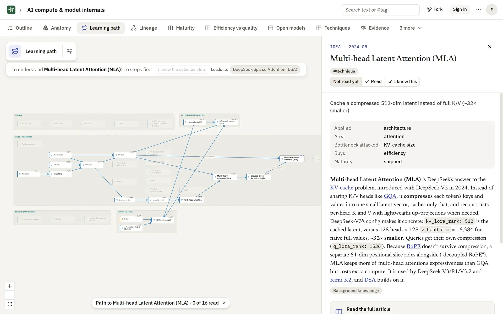

# Seply Learn

Seply Learn turns a question, an AI chat or a few files into an Expedition: a body of knowledge on one subject that you can read in several ways, share and keep growing.

[](https://github.com/mshafir/seply-learn/actions/workflows/ci.yml)
[](https://github.com/mshafir/seply-learn/actions/workflows/image.yml)
[](https://github.com/mshafir/seply-learn/releases?q=desktop-v&expanded=true)
[](https://github.com/mshafir/seply-learn/pkgs/container/seply-learn)
[](LICENSE)
[](https://seply.app)

**[Try it](https://learn.seply.app)** · **[Website](https://seply.app)** · **[Desktop app](https://seply.app/desktop/)** · **[Self-host](docs/self-host.md)**

<picture>
  <source media="(prefers-color-scheme: dark)" srcset="docs/images/learning-path-dark.webp">
  
</picture>

Seply is the umbrella for a family of LLM tools (Learn, Plan and Work). Seply Learn is the first. It was previously called Umbel Learn ([ADR 0002](docs/adr/0002-rename-to-seply.md)).

## What it does

### Expeditions and Concepts

An **Expedition** holds what you know about one subject. You start one from a question, and you can add **Sources**: pasted AI chats, files and links. Seply Learn splits the material into **Concepts**, each one well-defined chunk of knowledge with a one-line summary, an overview paragraph and an optional full article. Concepts are joined by typed **Relationships** such as "part of" or "prerequisite", and each Concept records which Sources it came from.

You can mark each Concept as read or already known. Views then show what you have covered.

### Views

A **View** answers one question about the Expedition and is laid out automatically from its Concepts. The same Concepts appear in every View, so all of them stay current as the Expedition grows. There are eleven View Types:

- **Outline:** what's in here, organised by topic
- **Learning path:** what to understand first, in order
- **Comparison table:** how options compare on chosen criteria
- **Cause and effect:** what drives what
- **Evidence:** what we believe, and why
- **Timeline:** what happens when
- **Map:** where everything is
- **Anatomy:** what a thing is made of, and where each idea fits
- **Lineage:** where an idea came from
- **Quadrant:** where each idea sits on two dimensions
- **Rates:** how fast things change, and how sure we are

Each View Type is defined in [`docs/view-types/`](docs/view-types/README.md).

### AI curation and suggestions

A curator agent builds the first version of an Expedition: it reads the Sources, proposes Views, then builds them one at a time while you watch. After that, the AI doesn't change shared content on its own. When you ask it to grow the Expedition, add a Source later, or connect an outside agent, its changes arrive as **suggestions** that you accept or dismiss item by item.

The AI runs on the server's key, its readers' own keys, or both, as the server chooses. On learn.seply.app, anyone can sign up and read, create and share; using the server's AI needs an approved account.

### Sharing and collaboration

- Invite people as editors or viewers, by email or by link.
- Make an Expedition private, unlisted (anyone with the link) or public. Public ones are listed on [Explore](https://learn.seply.app/explore).
- See who else is reading, with their cursors on the same View. Edits sync live.
- History lists every Change. You can undo one, view the Expedition as it was, or restore it.
- Fork an Expedition to make your own copy, and export it to JSON or a Markdown folder.

### The MCP server

Seply Learn has a remote MCP server at `/mcp`, so an agent such as Claude Code can read your Expeditions, create new ones from a conversation, and send suggestions to existing ones. It signs in with OAuth or a personal API token, and you choose which Expeditions it may use. The agent uses its own model, so MCP calls don't spend the server's AI key.

For Claude Code there is a plugin with the MCP server and a skill:

```sh
claude plugin marketplace add mshafir/seply-learn
claude plugin install seply-learn@seply
```

See [`plugins/seply-learn`](plugins/seply-learn/README.md) and the [MCP spec](docs/spec/v1/06-mcp.md).

### Desktop app

The desktop app opens Seply Learn in its own window, for macOS, Windows and Linux. It uses learn.seply.app or a server you choose, and opens `seply://` links. Downloads are on [seply.app/desktop](https://seply.app/desktop/) and in the [desktop releases](https://github.com/mshafir/seply-learn/releases?q=desktop-v&expanded=true). The builds aren't signed yet; [docs/desktop.md](docs/desktop.md) explains how to open them.

### Self-host

Seply Learn runs on your own machine or server as one container plus Postgres, with Docker Compose and your own AI key (Anthropic, OpenAI, Google, the Vercel AI Gateway, or any OpenAI-compatible server such as Ollama). People sign in with an email and password, or with Google if you set it up. Releases publish the image as `ghcr.io/mshafir/seply-learn`.

```sh
git clone https://github.com/mshafir/seply-learn.git
cd seply-learn
cp .env.example .env   # fill in the required values and an AI key
docker compose up -d
```

The [self-host guide](docs/self-host.md) covers AI keys, sign-in, email, S3 storage, map tiles, backups and upgrades.

## Getting started (development)

This is a TypeScript monorepo, managed with pnpm and Turborepo. [mise](https://mise.jdx.dev) provides Node and pnpm at the versions in `mise.toml`.

```sh
mise install
mise exec -- pnpm install
mise exec -- pnpm check            # dependency rule, typecheck, lint and tests
mise exec -- pnpm check:private    # no private data in tracked files
```

While working on one package, check just that one: `mise exec -- pnpm turbo typecheck lint test --filter=<package>...`.

- **The app:** build `apps/web`, run the Worker with `wrangler dev` against any Postgres, and open `http://localhost:8787`. The steps are in [Running it locally](docs/ops/deploy.md#running-it-locally). `mise exec -- pnpm --filter web dev` serves the frontend on port 5173 and proxies the API to the Worker.
- **The site:** `mise exec -- pnpm --filter @seply/site dev` serves seply.app on port 4321 ([`apps/site`](apps/site/README.md)).
- **The Node server:** the self-host entry is in [`apps/server-node`](apps/server-node/README.md).
- **The desktop app:** [`apps/desktop`](apps/desktop/README.md).

Each package's README states its contract. [`CLAUDE.md`](CLAUDE.md) has the working rules, and [`CONTEXT.md`](CONTEXT.md) the glossary that code and docs use.

## What's here

| Path | What it is |
|---|---|
| [`apps/`](apps/) | The web app (`web`), the Cloudflare Worker (`worker`), the Node server for self-hosting (`server-node`), the desktop app (`desktop`), the landing site (`site`) and the explainer video (`video`) |
| [`packages/`](packages/) | `domain` (the model and its ops), `sync`, `views` (renderers and layouts), `ui` (the design system), `ai` (the curator agent), `server` (the API, MCP and jobs) and shared `config` |
| [`docs/spec/v1/`](docs/spec/v1/README.md) | The v1 spec: domain model, architecture, screens, Views, AI, MCP, design system, landing site, desktop |
| [`docs/plan/v1/`](docs/plan/v1/README.md) | The v1 plan: milestones M0–M8, from foundations to the landing site and desktop app, and their work packages (tracked as GitHub Issues) |
| [`CONTEXT.md`](CONTEXT.md) | The glossary |
| [`docs/view-types/`](docs/view-types/README.md) | View Type definitions, written as instructions for curators and agents |
| [`docs/self-host.md`](docs/self-host.md), [`docs/desktop.md`](docs/desktop.md) | The self-host guide and the desktop install steps |
| [`docs/adr/`](docs/adr/) | Architecture decision records |
| [`docs/wayfinder/mindmaps-v1/`](docs/wayfinder/mindmaps-v1/map.md) | The planning map and the decision tickets behind the spec |
| [`plugins/seply-learn/`](plugins/seply-learn/README.md) | The Claude Code plugin: the MCP server and the `seply-learn` skill |
| [`prototypes/`](prototypes/) | Early prototypes of the Views and the curator playbook, kept for reference |

## Stack

- **Frontend:** React 19 and Vite, React Flow, shadcn with Base UI, Tailwind v4 with dark mode. An installable PWA.
- **Backend:** Hono on Cloudflare Workers (Durable Objects, Workflows, R2, Hyperdrive to Postgres on Neon). The same app runs on Node with Postgres for self-hosting.
- **Auth:** Better Auth.
- **AI:** AI SDK 7 for the curator agent. A remote MCP server for outside agents.
- **Desktop:** Electron. **Site:** Astro.

## Contributing

Issues and pull requests are welcome. Read [`CLAUDE.md`](CLAUDE.md) and the relevant [spec](docs/spec/v1/README.md) section first, keep to the glossary's words, and run `pnpm check` and `pnpm check:private` before opening a PR. This repository is public, so fixtures must be synthetic or already public. Personal chats never go in it.

## License

[MIT](LICENSE)
